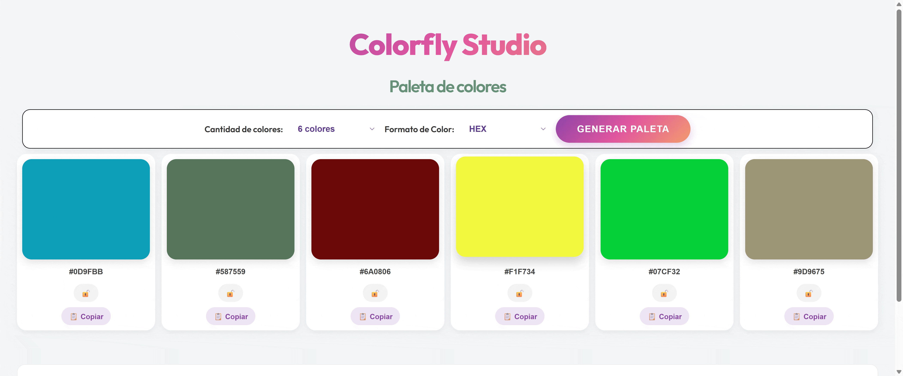
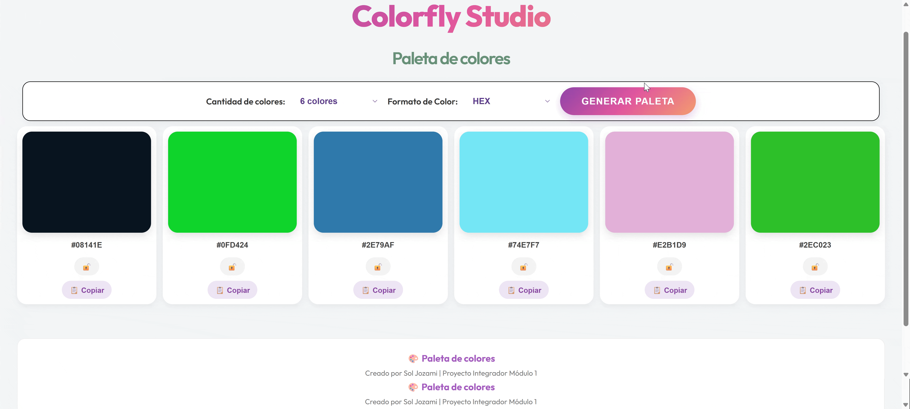
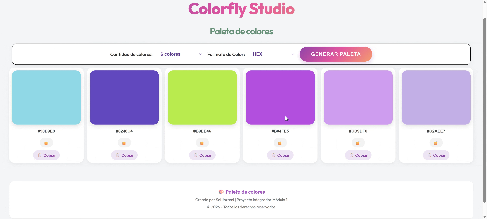
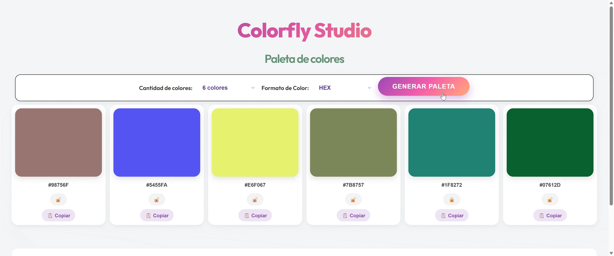
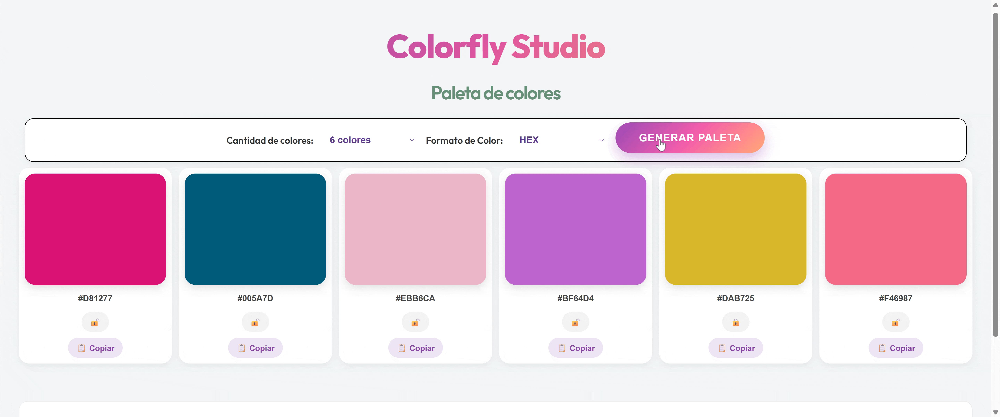
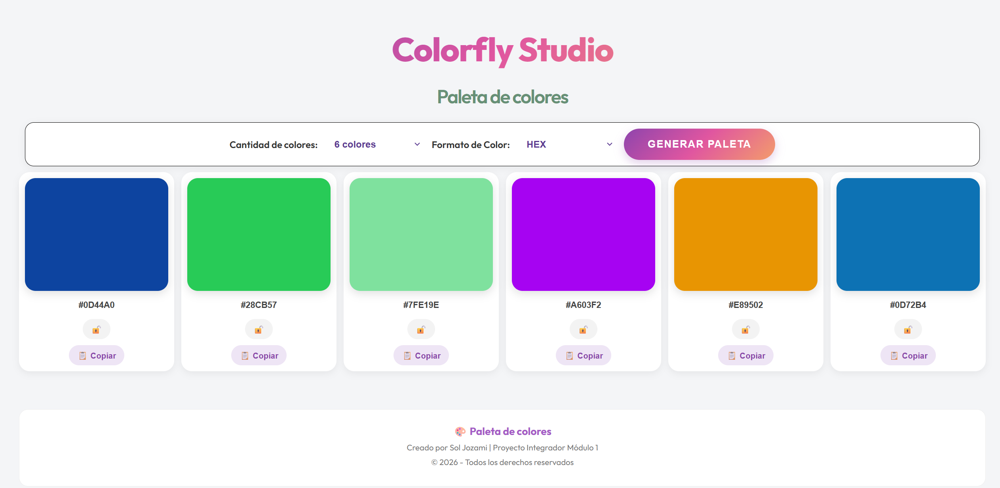
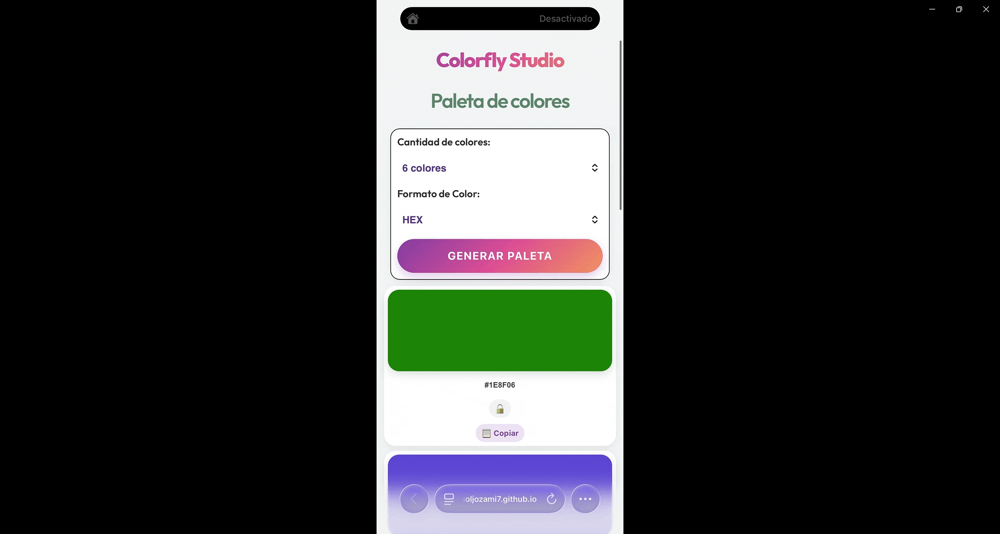

# 🌈 Colorfly Studio

## Descripción

Colorfly Studio es una aplicación web que permite generar paletas de colores aleatorias y explorar distintas combinaciones cromáticas.

Ofrece la posibilidad de elegir la cantidad de colores, visualizar sus códigos en formato HEX o HSL, bloquear colores para conservarlos al generar nuevas paletas y copiar sus códigos fácilmente.

## Demo online

Podés probar Colorfly Studio desde el siguiente enlace:

[🌈 Abrir Colorfly Studio](https://soljozami7.github.io/ProyectoM1_JozamiMariaSol-/)

## Cómo utilizar Colorfly Studio

La aplicación permite generar y personalizar paletas de colores de manera sencilla e intuitiva.

### 1. Generar una paleta

Al ingresar a la aplicación, se puede generar una combinación aleatoria de colores mediante el botón correspondiente.

### 2. Elegir la cantidad de colores

Es posible seleccionar entre 6, 8 o 9 colores. Al modificar la cantidad, la paleta se actualiza automáticamente.

### 3. Cambiar el formato de color

La aplicación permite visualizar los códigos de cada color en formato HEX o HSL. Al cambiar el formato, se conservan los mismos colores y solamente se modifica la representación de sus códigos.

### 4. Bloquear colores

Mediante la opción de bloqueo es posible conservar determinados colores al generar una nueva paleta. Los colores que no están bloqueados se reemplazan por otros aleatorios.

### 5. Copiar códigos de color

Cada color cuenta con una opción para copiar su código y utilizarlo fácilmente en otros proyectos.

## Diseño responsive

Colorfly Studio cuenta con un diseño adaptable a distintos dispositivos, permitiendo utilizar la aplicación tanto desde una computadora como desde un teléfono celular.

### Versión de escritorio

### Versión móvil

## Cómo ejecutar el proyecto localmente

Para visualizar Colorfly Studio en tu computadora, seguí estos pasos:

1. Ingresá al repositorio del proyecto en [GitHub](https://github.com/soljozami7/ProyectoM1_JozamiMariaSol-).

2. Hacé clic en el botón **Code**, copiá la URL del repositorio HTTPS.

3. Abrí **Visual Studio Code** y seleccioná la opción **Clone Git Repository**.

4. Pegá la URL que copiaste de GitHub y seleccioná la carpeta donde quieras guardar el proyecto.

5. Una vez finalizada la clonación, abrí el proyecto en Visual Studio Code.

6. Abrí el archivo `index.html`, hacé clic derecho y seleccioná **Open with Live Server**.

La aplicación se abrirá automáticamente en tu navegador y estará lista para usar.

**Requisitos:** tener instalado Git, Visual Studio Code y la extensión Live Server.

## Decisiones técnicas

### Tecnologías utilizadas

* **HTML:** utilizado para estructurar el contenido de la aplicación.
* **CSS:** utilizado para diseñar la interfaz, definir los estilos y adaptar la visualización a distintos dispositivos.
* **JavaScript:** utilizado para desarrollar la lógica y las funcionalidades interactivas de la aplicación.

### Decisiones de desarrollo

* Se estableció una paleta inicial de 6 colores, con opciones para generar 8 o 9.
* Se incorporó la posibilidad de visualizar los colores en formato HEX o HSL.
* Se implementó un sistema de bloqueo para conservar determinados colores al generar una nueva paleta.
* Se agregó la opción de copiar individualmente el código de cada color.
* Se diseñó una interfaz responsive para facilitar su uso desde distintos dispositivos.

## Pasos para realizar el despliegue

Para publicar Colorfly Studio en internet utilicé GitHub Pages.

1. Subí los archivos del proyecto a un repositorio de GitHub.
2. Ingresé a la sección **Settings** del repositorio.
3. Seleccioné la opción **Pages**.
4. En **Build and deployment**, elegí la rama `main` y la carpeta `/ (root)` como fuente de publicación.
5. Guardé los cambios y esperé a que GitHub Pages generara el sitio.

Una vez finalizado el proceso, la aplicación quedó disponible en el siguiente enlace:

[Colorfly Studio](https://soljozami7.github.io/ProyectoM1_JozamiMariaSol-/)

## Mejoras futuras

Para futuras versiones de Colorfly Studio, se proponen las siguientes mejoras:

* Permitir guardar paletas favoritas y consultar un historial de paletas generadas.
* Incorporar la opción de descargar una paleta como imagen.
* Agregar nuevos formatos de color.
* Incorporar un selector manual mediante un círculo cromático, que permita elegir un color y ajustar sus tonalidades (más claras, más oscuras, más saturadas, etc.), para luego bloquearlo e integrarlo a una paleta personalizada.

## Documentación del uso de IA

Durante el desarrollo de Colorfly Studio utilicé ChatGPT como herramienta de apoyo para el aprendizaje, la comprensión de conceptos de programación y la resolución de problemas.

Para conocer en detalle el proceso de trabajo, las consultas realizadas, las explicaciones recibidas y las evidencias de mi participación, podés consultar la 
[Ver documentación del uso de IA](uso-de-ia/readme.md)
