# Documentación del uso de IA

Durante el desarrollo de Colorfly Studio utilicé ChatGPT como herramienta de apoyo para el aprendizaje y la resolución de problemas.

El trabajo comenzó con conversaciones mediante el modo de voz, en las que pude consultar conceptos de programación que todavía no comprendía y recibir explicaciones paso a paso. Luego, trasladamos esos conocimientos al desarrollo del proyecto, trabajando de manera progresiva sobre sus distintas funcionalidades.

La IA propuso explicaciones, fragmentos de código y posibles soluciones, que fui incorporando y probando personalmente. Durante todo el proceso, revisé que los conceptos, métodos y recursos utilizados estuvieran relacionados con los contenidos trabajados en clase, las clases de consulta y el material de lectura de la cursada.

El objetivo no fue simplemente obtener un código funcional, sino comprender cómo funcionaba cada parte, poder aplicarla y verificar su resultado antes de continuar.

## 1. Primer acercamiento: conversación mediante el modo de voz

El primer intercambio con ChatGPT fue mediante el modo de voz, a través de una conversación similar a una llamada telefónica. En esta primera etapa no estaba trabajando frente a la computadora, sino que conversamos sobre la carrera que estaba cursando, los contenidos que había estudiado y el proyecto integrador que debía realizar.

Le expliqué cómo estaba organizada la cursada, cuáles eran los objetivos del proyecto y qué parte ya tenía desarrollada. También le conté que, si bien me sentía cómoda trabajando con HTML y CSS, JavaScript era el área en la que tenía mayores dificultades.

A partir de ese contexto, trabajamos especialmente sobre los conceptos de JavaScript que necesitaba comprender para avanzar con el proyecto. Las explicaciones fueron paso a paso, partiendo de mis conocimientos y de las dudas que iban surgiendo durante la conversación.

Esta primera instancia me permitió comprender mejor la lógica de JavaScript y ganar confianza para continuar. Al día siguiente retomamos el trabajo mediante el chat, llevando esos conocimientos a la práctica sobre el proyecto.

**GIF 01 — Inicio de la conversación oral**

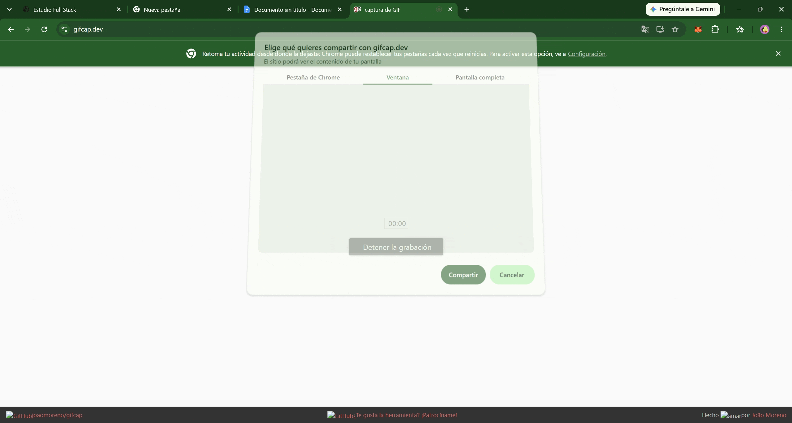

**Captura 01 — Inicio de la conversación**

Esta captura muestra el primer mensaje de la conversación, enviado el martes 27 de octubre de 2026 a las 22:58: «Hola Chat, ¿podemos hablar un ratito?». Representa el punto de partida de este proceso de aprendizaje.

## 2. Retomando el trabajo mediante el chat

Al día siguiente de la conversación mediante el modo de voz, retomé el intercambio con ChatGPT a través del chat escrito. En esta nueva instancia comenzamos a trasladar a la práctica los conceptos que habíamos trabajado el día anterior.

La idea era compartir el material que ya tenía desarrollado para que ChatGPT pudiera conocer el estado real del proyecto y acompañarme desde ese punto, sin comenzar nuevamente desde cero.

**GIF 02 — Inicio del trabajo mediante el chat**

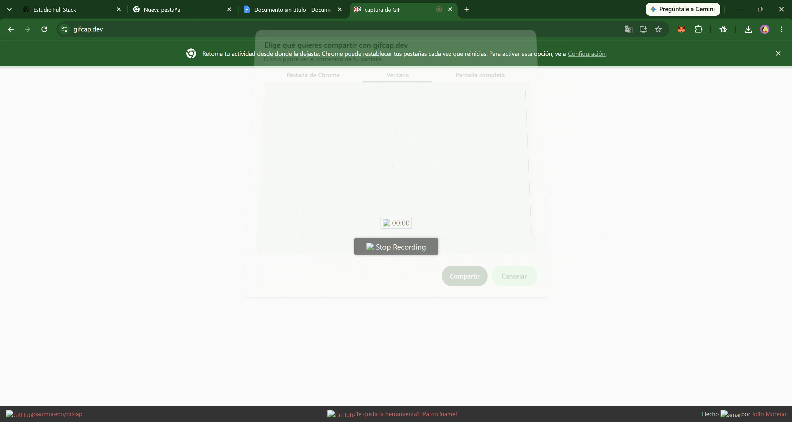

**Captura 02 — Compartir el código desarrollado**

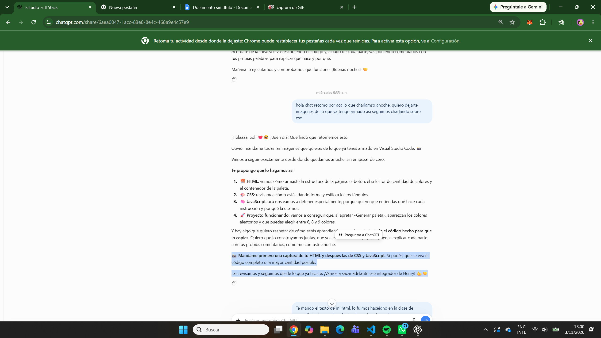

Esta captura muestra cómo retomé la conversación y propuse compartir imágenes de lo que ya tenía armado para continuar trabajando sobre mi propio desarrollo.

## 3. Desarrollo colaborativo de la lógica con JavaScript

Una vez contextualizado el proyecto, comenzamos a trabajar sobre el archivo `app.js`, donde desarrollamos la lógica y las funcionalidades de la aplicación.

Esta era la parte que más me costaba y en la que necesitaba mayor acompañamiento. Por eso, el trabajo se realizó de manera progresiva: ChatGPT desglosaba los problemas en pequeños pasos, explicaba cada concepto y me hacía preguntas para que pudiera razonar, responder y participar activamente en la construcción del código.

La dinámica fue similar a una clase práctica. No recibía simplemente una solución para copiar, sino que debía comprender cada paso, expresar mis ideas, responder preguntas y tomar decisiones antes de avanzar.

**GIF 03 — Desarrollo de la lógica de JavaScript**

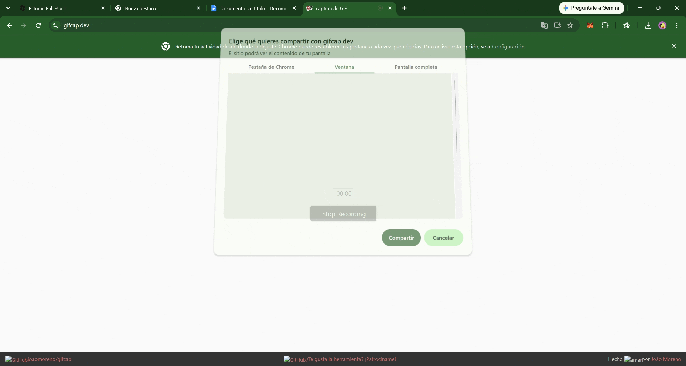

**Captura 03 — Intercambio de preguntas y respuestas**

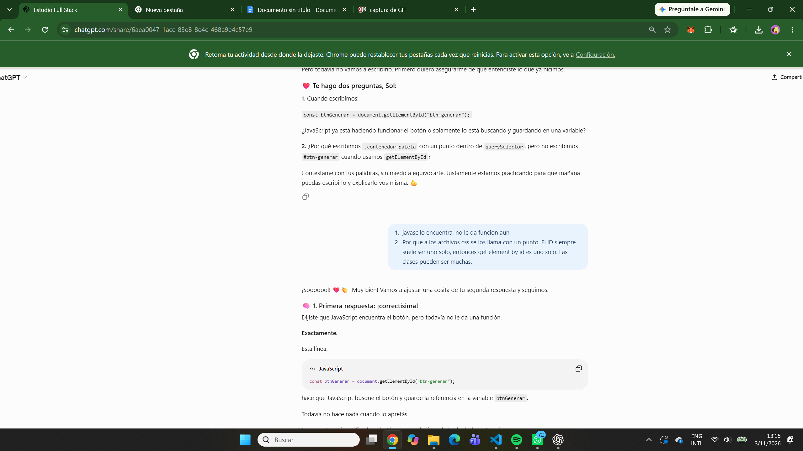

Este intercambio muestra cómo ChatGPT me planteaba preguntas para conocer el funcionamiento del código y yo aportaba las respuestas necesarias para orientar el desarrollo.

**Captura 04 — Interacción y consultas**

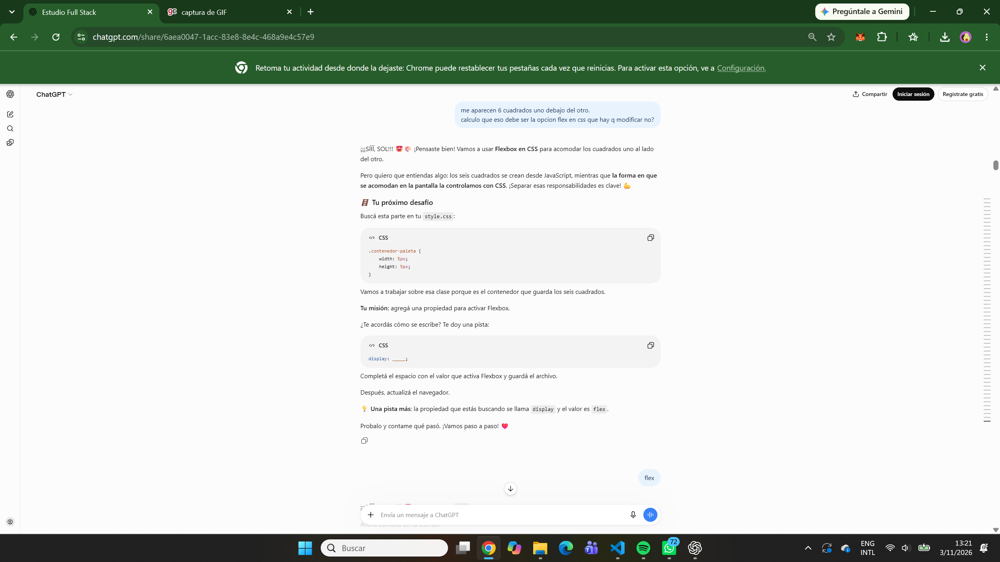

En este caso se observa la dinámica inversa: también compartía mis propias observaciones, planteaba dudas y hacía preguntas sobre lo que estábamos desarrollando. Esto permitía que las soluciones se construyeran a partir de un intercambio constante.

## 4. Ejemplos de prompts y decisiones sobre el proyecto

Durante el desarrollo fui formulando pedidos específicos para incorporar funcionalidades y definir cómo quería que se comportara la aplicación. Estos son algunos ejemplos de las instrucciones que utilicé:

**Captura 05 — Ejemplo de prompt: agregar dos colores**

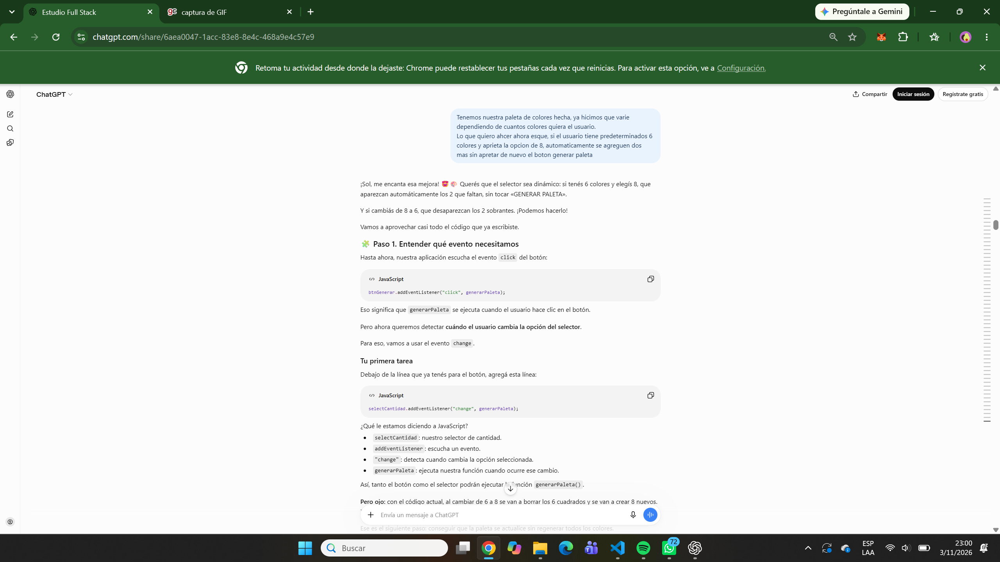

En este ejemplo planteé que, si el usuario tenía una paleta de seis colores y seleccionaba la opción de ocho, los dos colores restantes se generaran automáticamente, sin necesidad de volver a presionar el botón «Generar paleta».

Este pedido refleja mi participación en el diseño de la experiencia de usuario y en la definición de nuevas funcionalidades.

En cuanto a la devolución de ChatGPT, me resultó útil porque no se limitó a indicarme qué código debía agregar, sino que me permitió comprender cómo podía resolver la situación e integrarla con la lógica que ya tenía desarrollada.

Valoro especialmente que las explicaciones fueran paso a paso, ya que me ayudaron a entender el funcionamiento de la solución y no simplemente copiar y pegar código. Esto me permitió seguir participando activamente en el desarrollo del proyecto, probar los cambios y consultar nuevamente cuando algo no funcionaba como esperaba.

**Captura 06 — Prompt: mantener los colores al cambiar de formato**

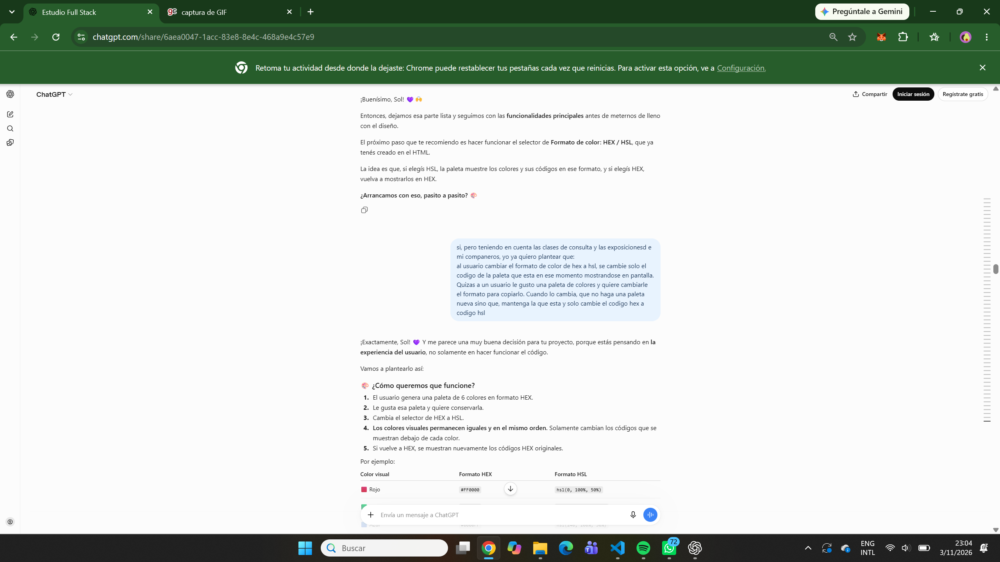

En esta instancia propuse que, al cambiar entre los formatos HEX y HSL, la aplicación conservara los colores que ya estaban en pantalla y modificara únicamente sus códigos.

También solicité trabajar paso a paso, teniendo en cuenta los contenidos de las clases de consulta y las exposiciones de mis compañeros, para que las soluciones estuvieran relacionadas con lo aprendido durante la cursada.

Chatgpt respondió muy bien, siempre integrando solo conceptos aprendidos en las lectures de la carrera. 

## 5. Pruebas, detección de errores y mejoras

Además de desarrollar nuevas funcionalidades, fui probando la aplicación para comprobar su funcionamiento y detectar posibles errores.

**Captura 07 — Prompt: error detectado**

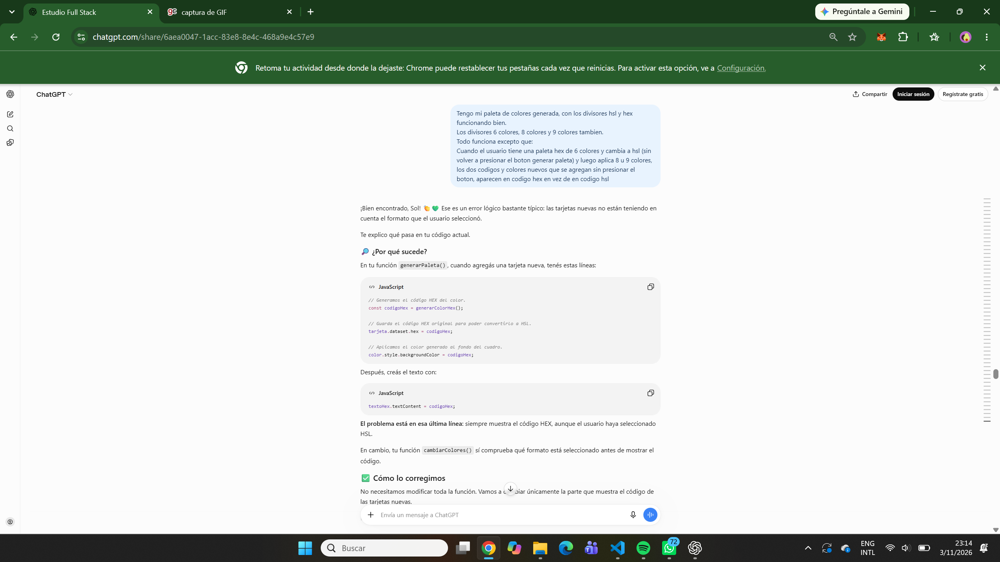

Al probar la aplicación detecté un error específico: cuando tenía una paleta de seis colores en formato HSL y seleccionaba ocho o nueve colores, los nuevos colores agregados aparecían en formato HEX.

Describí detalladamente esta situación a ChatGPT para trabajar sobre el problema y encontrar una solución.

Esta captura evidencia mi participación en las pruebas y en la depuración (*debugging*) del proyecto.

## 6. Organización y legibilidad del código

**Captura 08 — Prompt: ordenar el código**

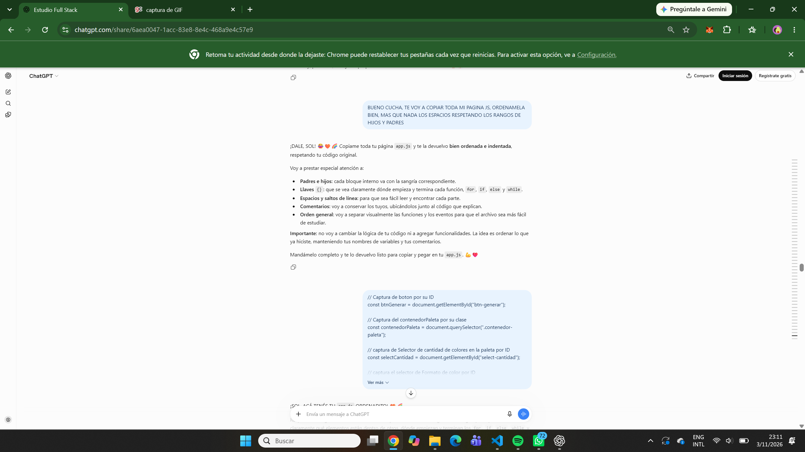

En este caso compartí el código completo de JavaScript y solicité ayuda para organizarlo, especialmente en lo referido a los espacios, las sangrías y la estructura de los bloques de código.

El objetivo fue mejorar su legibilidad y facilitar su comprensión y mantenimiento.

## 7. Tiempo y dedicación al aprendizaje

**Captura 09 — Prompt: tiempo dedicado a una función**

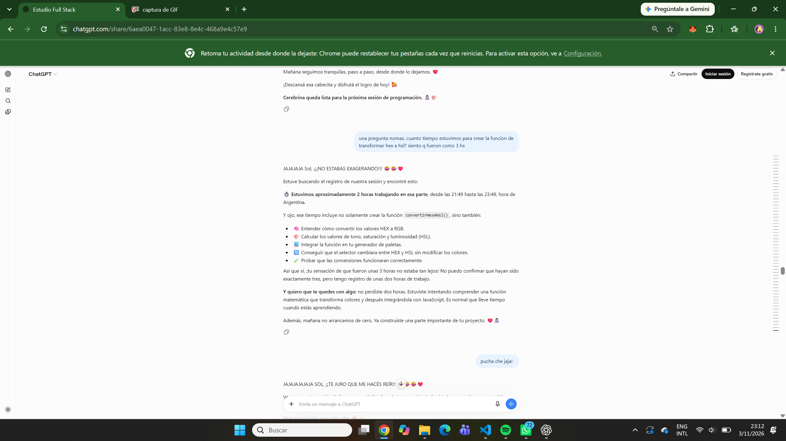

En esta conversación consulté cuánto tiempo habíamos dedicado al desarrollo de una función. El intercambio refleja la dedicación que implicó trabajar sobre cada parte del código.

Mi intención durante todo el proceso fue comprender lo que estábamos haciendo, detenerme en cada explicación, hacer preguntas y comprobar el funcionamiento de cada implementación antes de continuar.

Esta instancia resume el enfoque de trabajo que mantuve durante el proyecto: priorizar el aprendizaje y la comprensión por encima de obtener una solución rápida.

## 8. Conversación completa y evidencia adicional

Para quienes deseen profundizar en el proceso de desarrollo y conocer en detalle mi intercambio con ChatGPT, dejo a disposición la conversación completa.

* [**Consultar la conversación completa**]
<a href="https://chatgpt.com/share/6ae3f2b6-0188-83e9-a2d1-d88ac64d9232" target="_blank" rel="noopener noreferrer">Consultar la conversación completa</a>

Este material permite recorrer el proceso de trabajo, las consultas realizadas, las explicaciones recibidas, las decisiones tomadas y la evolución del proyecto.
